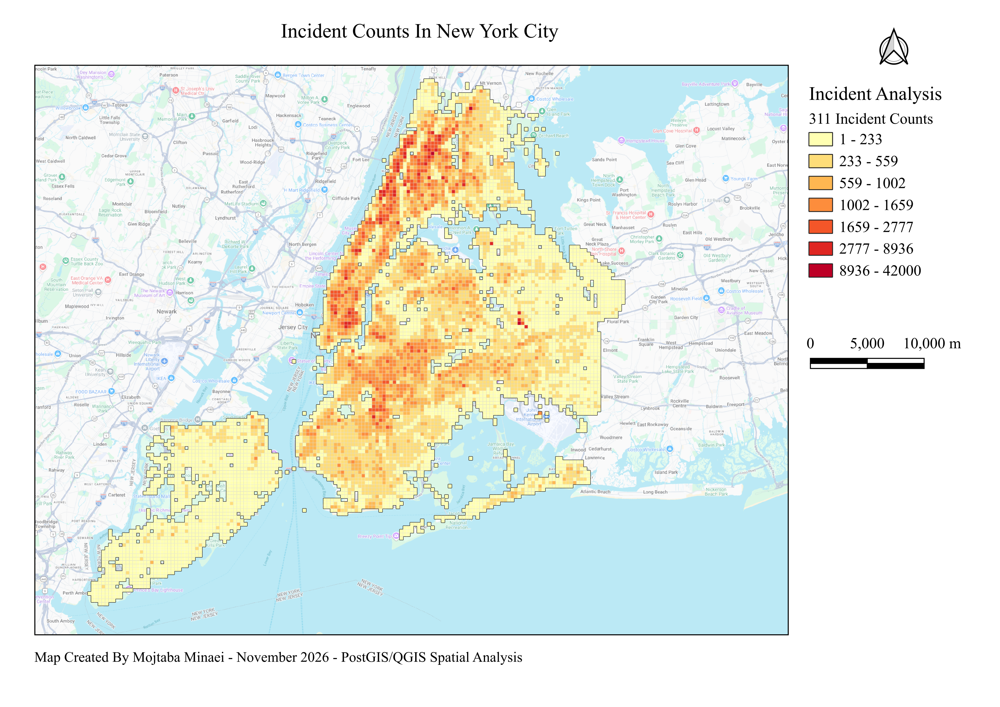

# NYC Urban Services, Incidents & Spatial Analysis

**A GIS and spatial database project analyzing NYC 311 service requests, incident hotspots, parcel-level patterns, and geographic proximity to public-service facilities using PostgreSQL, PostGIS, Python, and QGIS.**

---

## Project Overview

This project explores the spatial distribution of New York City's 311 service requests during 2021 and examines how recorded incidents relate geographically to tax parcels, FDNY firehouses, and selected pharmacy locations.

The project uses a spatial database workflow to integrate multiple datasets, perform spatial and statistical analyses, and produce thematic maps and analytical outputs.

Rather than treating incident records as isolated points, the project examines their spatial concentration at multiple geographic levels:

- **Citywide:** Identifying areas with high concentrations of 311 incidents.
- **Grid-based:** Aggregating incidents into regular spatial units to identify hotspots.
- **Parcel-level:** Linking incidents to tax parcels to examine the distribution of recorded complaints.
- **Facility proximity:** Measuring straight-line distances between incidents or parcels and selected public-service facilities.

The project demonstrates an end-to-end geospatial workflow, from data ingestion and quality control to spatial analysis, database management, and cartographic presentation.

## Objectives

The main objectives are to:

1. Build a structured PostgreSQL/PostGIS database for managing multiple spatial and non-spatial datasets.
2. Clean, validate, and standardize source data before analysis.
3. Identify spatial concentrations of NYC 311 incidents using grid-based hotspot analysis.
4. Integrate incident records with NYC tax parcels using BBL identifiers and spatial assignment where applicable.
5. Examine the geographic proximity of incidents and parcels to FDNY firehouses.
6. Explore parcel-level proximity to recorded Rite Aid locations.
7. Produce reproducible analytical outputs and publication-quality maps using SQL and QGIS.

## Technology Stack

| Technology | Role |
|---|---|
| PostgreSQL | Relational database management |
| PostGIS | Spatial data storage, querying, and analysis |
| SQL | Data preparation, quality control, spatial processing, and analytical queries |
| Python | Database connectivity and supporting analytical workflow |
| QGIS | Spatial visualization, cartography, and map production |
| Docker | Database environment deployment |
| Git & GitHub | Version control and project documentation |

## Data Sources

The project integrates several datasets covering New York City.

| Dataset | Description | Analytical purpose |
|---|---|---|
| NYC 311 Service Requests (2021) | Service-request records submitted through NYC's 311 system. | Incident distribution, hotspot analysis, and parcel-level incident profiles. |
| NYC MapPLUTO | Tax parcel boundaries and associated land-use and building attributes. | Parcel-level spatial integration and analysis. |
| FDNY Firehouse Locations | Locations of 219 FDNY firehouses. | Nearest-firehouse proximity analysis. |
| Rite Aid Locations | A prepared dataset containing 100 recorded Rite Aid locations. | Geographic proximity analysis at the parcel level. |
| Weather Station Records | Hourly observations from 126 weather stations, covering July 23–24, 2023. | Retained as an additional dataset for potential exploration; not directly integrated with the 2021 incident analysis. |

**Data considerations:** The datasets have different temporal coverage and geographic characteristics. In particular, the weather observations do not align temporally with the 2021 incident records and are not used to establish relationships between weather conditions and incidents.

## Database Architecture

The project uses a PostgreSQL database named `nyc_urban`, with PostGIS enabled.

The database is organized into three schemas:

| Schema | Purpose |
|---|---|
| `raw` | Imported source datasets. |
| `core` | Cleaned and standardized datasets prepared for analysis. |
| `analysis` | Derived datasets containing spatial and statistical analysis results. |

### Processing workflow

```text
                 SOURCE DATASETS
                       |
                       v
                 +-----------+
                 |    raw    |
                 +-----------+
                       |
                       v
              Data Cleaning & QC
                       |
                       v
                 +-----------+
                 |   core    |
                 +-----------+
                       |
                       v
              Spatial & Statistical
                    Analysis
                       |
                       v
                 +-----------+
                 |  analysis |
                 +-----------+
                       |
                       v
               SQL Outputs & QGIS
                 Visualization
```

The principal spatial datasets use **EPSG:2263 (NAD83 / New York Long Island)**, a projected coordinate reference system suitable for spatial measurements in the NYC study area.

## Analytical Workflow

### 1. Data Ingestion and Preparation

Source datasets are imported into PostgreSQL and organized in the `raw` schema.

The preparation process includes:

- Standardizing identifiers and attribute fields.
- Preparing spatial geometries for analysis.
- Converting source coordinates into the project's projected coordinate reference system.
- Handling missing and invalid spatial records.
- Preserving relevant identifiers for traceability.

### 2. Data Quality Control

Quality-control queries are used to inspect the imported and prepared datasets.

Checks include:

- Missing values and incomplete records.
- Duplicate identifiers.
- Invalid or missing geometries.
- Unmatched parcel identifiers.
- Spatial consistency and record counts.

For the 2021 311 dataset, 3,142,352 records have valid geometries out of 3,214,361 total records. Records without usable geometries are excluded from analyses requiring spatial locations.

### 3. Incident Hotspot Analysis

Incident locations are aggregated into a regular grid of **1,000 ft × 1,000 ft** cells.

The resulting 7,620 occupied grid cells are classified according to incident counts using empirical percentile thresholds:

| Classification | Threshold |
|---|---|
| Other | Below the 90th percentile |
| High | 90th percentile and above |
| Very High | 95th percentile and above |
| Extreme | 99th percentile and above |

The classifications are mutually exclusive. They are based on the observed distribution of incident counts rather than predefined administrative standards.

### 4. Parcel-Level Incident Analysis

NYC 311 incidents are associated with MapPLUTO tax parcels primarily through their BBL (Borough-Block-Lot) identifiers.

For eligible incidents without a usable BBL, spatial assignment is used where valid geometry permits.

The resulting parcel-level profiles include:

- Total incident count.
- Number of distinct complaint types.
- Number of represented agencies.
- First and last recorded incident timestamps.
- Selected parcel and building characteristics.

### 5. Nearest-Facility Proximity Analysis

PostGIS spatial nearest-neighbor operations are used to calculate the straight-line distance between spatial features and their nearest facilities.

Two main proximity analyses are performed:

- **FDNY firehouses:** Distance from incident locations, hotspot cells, and tax parcels to the nearest firehouse.
- **Rite Aid locations:** Distance from tax parcels to the nearest recorded Rite Aid location.

These measurements represent geographic proximity, not road-network travel distance, response time, actual service coverage, or comprehensive healthcare accessibility.

### 6. Integrated Analysis and Visualization

The hotspot and firehouse datasets are integrated to examine the relationship between incident concentration and nearest-firehouse distance.

The final analytical tables are connected to QGIS for thematic mapping, cartographic layout design, and statistical visualization.

## Key Findings

The following results summarize the principal analyses.

### NYC 311 Incident Hotspots

- **3,214,361** total 311 records were included in the 2021 dataset.
- **3,142,352** records had valid spatial geometries.
- **7,620** occupied grid cells were generated using a 1,000 ft × 1,000 ft grid.
- The High, Very High, and Extreme categories together contained **1,272,440 incidents**, approximately **40.5%** of all spatially valid incidents.

### Parcel-Level Incident Profiles

- **856,997** tax parcels were included.
- **453,193** parcels had at least one associated incident.
- **2,820,963** incidents were linked to parcels.
- The mean incident count among all parcels was approximately **3.29**.

One parcel recorded 30,589 incidents, of which approximately 99.97% were classified as Noise - Residential. This illustrates the potential for individual locations and complaint categories to strongly influence parcel-level incident counts.

### FDNY Firehouse Proximity

Across spatially valid incident locations:

- Mean distance to the nearest firehouse: **0.405 miles**.
- Median distance: **0.356 miles**.
- 97.38% of incidents were within one straight-line mile of a firehouse.

For NYC tax parcels:

- Mean distance: **0.513 miles**.
- Median distance: **0.464 miles**.

### High-Density Hotspots and Firehouse Proximity

Among the 762 High, Very High, and Extreme hotspot cells:

- 660 cells (86.6%) were within 0.5 miles of their nearest firehouse.
- 759 cells (99.6%) were within one mile.
- Only three cells were more than one mile away.

These three cells were isolated for focused spatial inspection.

### Rite Aid Proximity

The prepared dataset contained 100 recorded Rite Aid locations:

- 70 in Brooklyn.
- 30 in Queens.
- None in the Bronx, Manhattan, or Staten Island.

The mean parcel-to-nearest-Rite-Aid distance was approximately **3.375 miles**.

This result describes the geographic distribution of the recorded Rite Aid locations and parcel proximity to them. It should not be interpreted as a comprehensive measure of healthcare access.

For detailed results and interpretation, see [`docs/findings.md`](docs/findings.md).

## Maps and Analytical Outputs

The project includes five principal cartographic outputs, illustrating incident concentration, parcel-level patterns, and proximity to selected public-service facilities.

### 1. NYC 311 Incident Hotspots



Citywide distribution of 2021 NYC 311 incidents aggregated into a regular 1,000 ft × 1,000 ft grid and classified by incident density.

### 2. Incident Hotspots and FDNY Firehouse Proximity


Integrated visualization of incident-density classes and straight-line proximity to the nearest FDNY firehouse.

### 3. High-Incident Parcels and Rite Aid Proximity


Two-panel comparison of incident concentration and straight-line distance to the nearest recorded Rite Aid location among high-incident NYC parcels.

### 4. NYC Parcel Proximity to FDNY Firehouses


Parcel-level visualization of straight-line distance to the nearest of 219 FDNY firehouses.

### 5. Distant High-Density 311 Hotspots


Focused examination of the three high-density hotspot cells located more than one straight-line mile from their nearest FDNY firehouse.

### SQL Analytical Outputs

The project includes seven SQL presentation outputs supporting the final analyses and visualizations.

| Output | SQL file | Description |
|---|---|---|
| 01 | `01_hotspot_map.sql` | Citywide 311 incident hotspot grid. |
| 02 | `02_integrated_hotspot_firehouse.sql` | Incident density and proximity to FDNY firehouses. |
| 03 | `03_parcel_incident_profiles.sql` | Parcel-level incident profiles. |
| 04 | `04_high_incident_parcels_rite_aid_distance.sql` | High-incident parcels and proximity to Rite Aid locations. |
| 05 | `05_parcel_firehouse_accessibility.sql` | Parcel proximity to FDNY firehouses. |
| 06 | `06_distant_high_density_hotspots.sql` | High-density hotspot cells located more than one mile from a firehouse. |
| 07 | `07_density_firehouse_distance_summary.sql` | Summary statistics comparing hotspot density classes and firehouse distances. |

The QGIS project is available at `qgis/nyc_urban_analysis.qgz` and contains the project's spatial layers, thematic styling, and map layouts.

## Repository Structure

```text
nyc-urban-spatial-analysis/
│
├── README.md
├── LICENSE
├── .gitignore
│
├── data/
│   ├── raw/
│   │   └── README.md
│   └── processed/
│       └── README.md
│
├── sql/
│   ├── 00_setup/
│   ├── 01_ingestion/
│   ├── 02_quality_control/
│   ├── 03_core/
│   ├── 04_analysis/
│   └── 05_outputs/
│
├── src/
│   └── database.py
│
├── qgis/
│   └── nyc_urban_analysis.qgz
│
├── docs/
│   ├── data_dictionary.md
│   ├── database_schema.md
│   ├── methodology.md
│   └── findings.md
│
└── outputs/
```

## Documentation

Additional documentation is available in the `docs/` directory.

| Document | Description |
|---|---|
| [Methodology](docs/methodology.md) | Data preparation, spatial methods, analytical procedures, and methodological limitations. |
| [Findings](docs/findings.md) | Detailed analytical results and their interpretation. |
| [Data Dictionary](docs/data_dictionary.md) | Dataset descriptions, field definitions, and data-quality notes. |
| [Database Schema](docs/database_schema.md) | Database architecture, schema organization, and principal data relationships. |

## Reproducing the Project

The project is organized to support a staged and reproducible workflow.

### Prerequisites

- PostgreSQL.
- PostGIS extension.
- Docker.
- Python 3.11 or compatible version.
- QGIS.
- Git.

### Setup

**1. Clone the repository**

```bash
git clone <repository-url>
cd nyc-urban-spatial-analysis
```

**2. Prepare the database environment**

Set up the PostgreSQL/PostGIS environment using the project's Docker configuration and create the `nyc_urban` database.

**3. Install Python dependencies**

Create and activate a virtual environment, then install the required packages:

```bash
python -m venv .venv
```

On Windows:

```bash
.venv\Scripts\activate
```

Install the main Python dependencies:

```bash
pip install pandas psycopg[binary] SQLAlchemy
```

**4. Configure database connectivity**

Configure the database connection parameters used by `src/database.py`.

Do not commit database passwords or other credentials to the repository.

**5. Prepare the source data**

Obtain the required source datasets and follow the instructions in:

- `data/raw/README.md`
- `data/processed/README.md`

**6. Execute the SQL workflow**

Run the SQL scripts in their intended order:

1. `sql/00_setup/`
2. `sql/01_ingestion/`
3. `sql/02_quality_control/`
4. `sql/03_core/`
5. `sql/04_analysis/`
6. `sql/05_outputs/`

**7. Open the QGIS project**

Open `qgis/nyc_urban_analysis.qgz` in QGIS and configure the PostgreSQL connection to access the analytical datasets.

The QGIS project depends on the database and its analytical tables being available.

## Limitations

Several limitations should be considered when interpreting the results:

- 311 records represent reported service requests and do not necessarily correspond to independently verified incidents.
- Incident counts may be influenced by reporting behavior, population distribution, land use, and other contextual factors.
- Some records lack usable spatial geometries or matching parcel identifiers.
- Nearest-facility distances are straight-line measurements and do not account for transportation networks, traffic, dispatch procedures, or operational availability.
- The pharmacy analysis uses a limited set of recorded Rite Aid locations rather than a comprehensive inventory of pharmacies or healthcare facilities.
- The hotspot density thresholds are empirical and project-specific.
- The weather dataset covers July 2023, whereas the main incident analysis covers 2021; therefore, no direct temporal relationship is established between these datasets.

For a fuller discussion of assumptions and limitations, see [`docs/methodology.md`](docs/methodology.md).

## Conclusion

This project demonstrates an end-to-end geospatial analysis workflow built around PostgreSQL, PostGIS, Python, and QGIS.

By integrating large-scale 311 service-request records with tax parcels and selected facility locations, it explores incident concentration at multiple spatial scales and evaluates geographic proximity to public-service facilities.

The project emphasizes structured spatial data management, reproducible SQL workflows, spatial database operations, analytical interpretation, and clear cartographic communication.

---

**Author:** [Your Name]

**Project:** NYC Urban Services, Incidents & Spatial Analysis

**Tools:** PostgreSQL · PostGIS · Python · QGIS · Docker